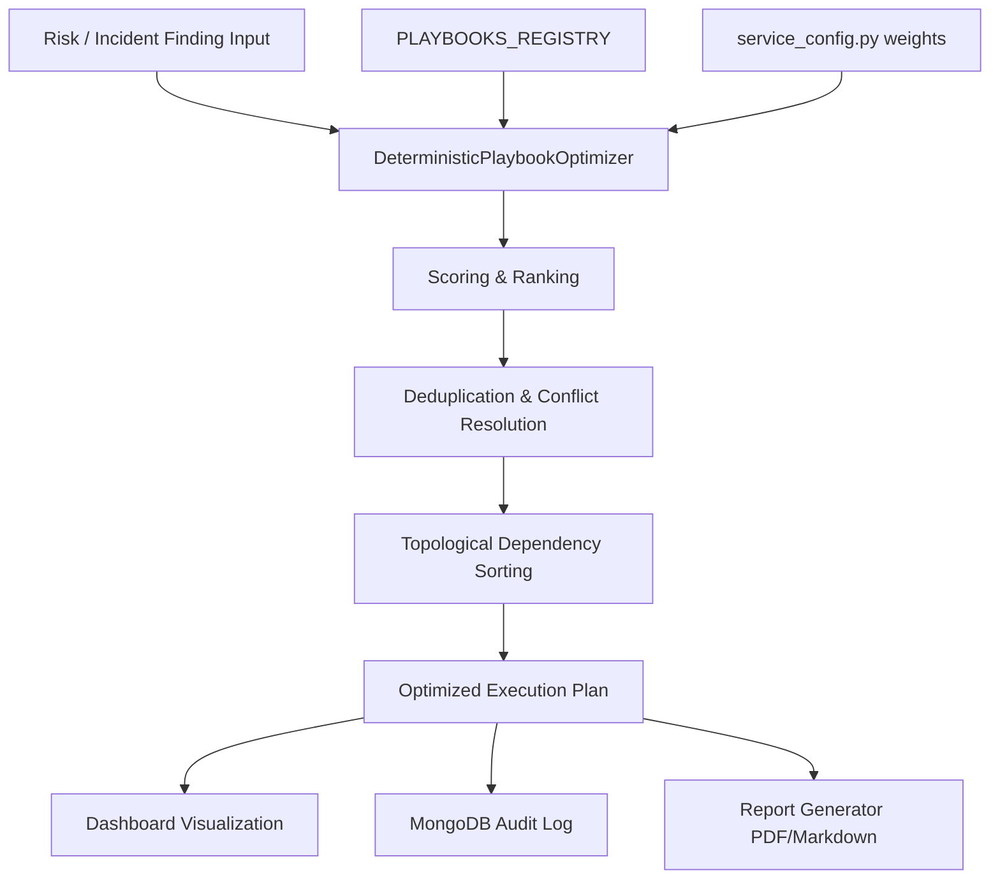

# SOAR Playbook Optimization Layer Documentation

This document describes the design, implementation, and academic rationale behind the deterministic, explainable, and reproducible playbook optimization layer introduced in Sprint 28.

---

## 1. Architectural Overview

The Playbook Optimization Layer operates as an independent, decoupled package within the `automation-engine` microservice located at [src/optimizer/](file:///c:/Users/HP/.gemini/antigravity-ide/scratch/Adaptive-AI-Driven-Quantum-Aware-DevSecOps-Framework/automation-engine/src/optimizer/). Future optimization strategies (such as Reinforcement Learning, Multi-Objective optimization, or Genetic Algorithms) can easily replace the deterministic baseline by implementing the abstract interface class `BaseOptimizer` located in [base.py](file:///c:/Users/HP/.gemini/antigravity-ide/scratch/Adaptive-AI-Driven-Quantum-Aware-DevSecOps-Framework/automation-engine/src/optimizer/base.py).



### 1.1 Strategy Pattern & Factory
The optimizers are instantiated dynamically using the strategy pattern factory defined in [__init__.py](file:///c:/Users/HP/.gemini/antigravity-ide/scratch/Adaptive-AI-Driven-Quantum-Aware-DevSecOps-Framework/automation-engine/src/optimizer/__init__.py):
```python
def get_optimizer(optimizer_type: str = "deterministic") -> BaseOptimizer:
    ...
```

---

## 2. Playbook Enriched Metadata

The `Playbook` registry model has been enriched with the following attributes for deterministic prioritization:
- **Category**: Determines high-level grouping (e.g., `"Isolation"`, `"Configuration"`, `"Access Control"`) used for deduplication.
- **Compatible Cloud**: Cloud provider target requirement (`"aws"`, `"azure"`, `"gcp"`).
- **Rollback Supported**: Explicit boolean indicating if the remediation supports rolling back the environment.
- **Recovery Score**: Floating-point value $[1.0, 10.0]$ representing return speed and baseline service quality.
- **Disruption Score**: Floating-point value $[1.0, 10.0]$ representing downtime and impact on operational users.
- **Execution Priority**: Configured policy level priority (`"Critical"`, `"High"`, `"Medium"`, `"Low"`).
- **Mitigation Tags**: Categorization markers.

---

## 3. Playbook Scoring Algorithm

Playbook scoring is 100% deterministic, reproducible, and explainable. Parameter weights are managed via the centralized configuration file [service_config.py](file:///c:/Users/HP/.gemini/antigravity-ide/scratch/Adaptive-AI-Driven-Quantum-Aware-DevSecOps-Framework/automation-engine/src/service_config.py).

### Configured Formula
$$\text{Priority Score} = (\text{Severity Weight} \times W_{severity}) + (\text{URS} \times W_{urs}) + (\text{Recovery Score} \times W_{recovery}) + (\text{Policy Priority} \times W_{policy}) + (\text{Confidence} \times W_{confidence}) + (\text{Disruption} \times W_{disruption}) + (\text{Execution Time} \times W_{time})$$

### Default Weights Configuration
- $W_{severity} = 2.0$ (Severity factor based on critical=4, high=3, medium=2, low=1)
- $W_{urs} = 0.3$ (Impact of current URS)
- $W_{recovery} = 2.5$ (Speed/baseline restoration)
- $W_{policy} = 2.0$ (Policy level weight based on critical=4, high=3, medium=2, low=1)
- $W_{confidence} = 5.0$ (AI prediction confidence)
- $W_{disruption} = -1.5$ (Operational impact penalty)
- $W_{time} = -0.1$ (Execution duration penalty)

---

## 4. Execution Chain Planning

### 4.1. Deduplication & Conflicts
- **Deduplication**: If multiple playbooks match the same anomaly category, the playbook with the highest priority score is selected, and duplicates are excluded.
- **Conflict Resolution**: Playbooks containing IDs in their `conflicts` property are checked against the active chain; any violating candidates are automatically filtered out.

### 4.2. Dependency & Kahn's Topological Sort
- Transitive dependencies are expanded from the registry (`playbook.dependencies` and `playbook.prerequisites`).
- A topological sort (Kahn's algorithm) resolves the execution order. If multiple independent tasks exist in a layer, they are sorted by Priority Score to guarantee a fully deterministic layout.

---

## 5. Research Evidence & Explainability

### 5.1 Optimizer Metadata
Every optimization result contains metadata parameters:
- `name`: `"Deterministic Playbook Optimization Engine"`
- `version`: `"1.0"`
- `type`: `"Rule Based"`
- `deterministic`: `true`
- `explainable`: `true`
- `requiresTraining`: `false`

### 5.2 Aligned Score Breakdown
Every selected playbook generates a granular score breakdown:
```json
{
  "scoreBreakdown": {
    "severity": 18.0,
    "urs": 22.0,
    "recovery": 12.0,
    "policy": 10.0,
    "confidence": 8.0,
    "disruptionPenalty": -3.0,
    "executionPenalty": -2.0,
    "finalScore": 65.0
  }
}
```

Every optimization run is logged in the `automation_audit` collection inside MongoDB.
