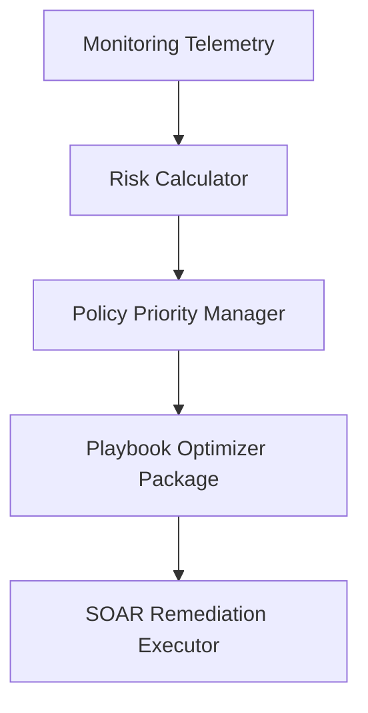

# Deterministic Playbook Optimization & Closed-Loop DevSecOps SOAR Framework

This repository houses a research-grade DevSecOps Orchestration framework featuring a Deterministic Playbook Optimization Engine.

---

## 1. System Architecture

---

## 2. Key Features
- **Independent Priority Layer**: Configurable multi-factor prioritizing rules.
- **Reproducible Performance**: 100% deterministic, zero-variance output ordering.
- **Explainability Details**: Exposes score breakdowns under execution contracts.
- **Topological Precedence Kahn Sorts**: Enforces dependency hierarchies.

---

## 3. Installation & Usage
Please consult [INSTALLATION_GUIDE.md](INSTALLATION_GUIDE.md) and [REPRODUCIBILITY_GUIDE.md](REPRODUCIBILITY_GUIDE.md) for local configuration steps.
