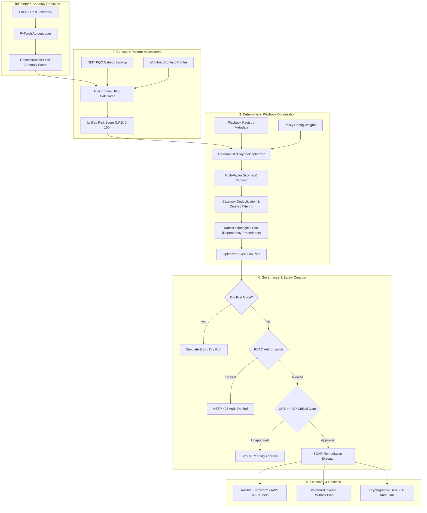

# Deterministic Playbook Optimization & Closed-Loop DevSecOps SOAR Framework

[](https://www.python.org/)
[](LICENSE)
[-brightgreen.svg)](tests/)
[](benchmarks/)
[](automation-engine/)

A research-grade DevSecOps Orchestration and SOAR (Security Orchestration, Automation, and Response) framework engineered around a **Deterministic Multi-Factor Playbook Optimization Engine**. The framework resolves complex incident findings into topologically valid, conflict-free, and deduplicated remediation execution plans with full dry-run simulation, cryptographic audit trails, role-based access control, approval gates, and automated rollback capabilities.

---

## Table of Contents
1. [Implementation Truth & Capabilities Disclosure](#1-implementation-truth--capabilities-disclosure)
2. [System Architecture](#2-system-architecture)
3. [Concrete Real-World Use Case](#3-concrete-real-world-use-case)
4. [Playbook Optimization Core Algorithm](#4-playbook-optimization-core-algorithm)
5. [Automated Remediation Controls](#5-automated-remediation-controls)
6. [API Contracts & Endpoints](#6-api-contracts--endpoints)
7. [Visual Interfaces & Workflows](#7-visual-interfaces--workflows)
8. [Setup & Installation from Clean Checkout](#8-setup--installation-from-clean-checkout)
9. [Test Execution Commands](#9-test-execution-commands)
10. [Reproducible Benchmarks & Measured Results](#10-reproducible-benchmarks--measured-results)
11. [Repository Structure](#11-repository-structure)

---

## 1. Implementation Truth & Capabilities Disclosure

In the interest of scientific integrity and clear software documentation, this framework explicitly clarifies the nature of its components:

| Component Claim | Actual Implementation Reality | Architectural Detail |
| :--- | :--- | :--- |
| **Playbook Optimization Engine** | **Deterministic Multi-Factor Rule-Based Optimizer (100% Implemented)** | Operates using Kahn's topological sort algorithm, multi-attribute priority scoring, mutual conflict detection, category deduplication, and zero-variance execution order generation. |
| **AI Threat Anomaly Engine** | **Classical PyTorch Neural Autoencoder Baseline** | A 4-layer feedforward autoencoder trained to calculate telemetry reconstruction loss across CPU, memory, disk, and network I/O. It does **not** employ generative AI or Reinforcement Learning (RL) agents for decision-making. |
| **Quantum-Aware Readiness Engine** | **Rule-Based NIST PQC Cryptographic Posture Lookup** | Matches scanned host algorithm identifiers (e.g., `RSA-2048`, `ECC P-256`) against a static NIST Post-Quantum Cryptography transition lookup catalog (`quantum_profiles.json`). It assigns migration urgency and recommends PQC algorithms (e.g., ML-KEM / Kyber, ML-DSA / Dilithium). **No physical quantum hardware is accessed.** |
| **Quantum Simulation** | **Classical Qiskit Bloch Sphere Visualizer** | A mathematical simulation script running on classical CPU hardware to visualize state vector rotations. |

> [!NOTE]
> The primary scientific and operational innovation of this framework lies in its **provably deterministic, conflict-free, and dependency-respecting SOAR playbook orchestrator**, eliminating the unpredictability, high downtime, and dependency cycles of naive heuristics.

---

## 2. System Architecture

The framework operates a closed-loop security automation pipeline:



---

## 3. Concrete Real-World Use Case

### Scenario: Unauthorized Outbound Cryptomining on an AWS EC2 Production Workload

1. **Incident Trigger**:
   - Monitoring telemetry reports CPU utilization at **96.8%**, accompanied by sustained abnormal outbound network traffic over port 3333 to an external mining pool.
   - Anomaly loss crosses detection threshold (`loss = 0.384`).
   - The Risk Engine correlates telemetry with business hours and production tagging, yielding a **Unified Risk Score (URS) of 95.0 (Critical Severity)**.

2. **Candidate Playbook Selection & Filtering**:
   - The system queries `PLAYBOOKS_REGISTRY` for matching remediations:
     - `pb_quarantine_net` (Category: Network, Prerequisite for process termination, Recovery: 7.0, Disruption: 1.5)
     - `pb_kill_miner_process` (Category: Process, Depends on `pb_quarantine_net`, Recovery: 9.0, Disruption: 2.0)
     - `pb_snapshot_live` (Category: Forensics, Conflicts with `pb_kill_miner_process`, Disruption: 7.0)
     - `pb_block_port_only` (Category: Network, Redundant with `pb_quarantine_net`)

3. **Deterministic Optimization Execution**:
   - **Multi-Factor Scoring**: Evaluates severity, recovery gain, disruption penalties, and policy priorities.
   - **Conflict Resolution**: `pb_snapshot_live` is rejected due to active conflict with the higher-priority process termination.
   - **Category Deduplication**: `pb_block_port_only` is discarded as redundant since the higher-ranked `pb_quarantine_net` already isolates network traffic.
   - **Kahn's Topological Precedence**: Enforces that `pb_quarantine_net` **must execute first** (Stage 1), followed by `pb_kill_miner_process` (Stage 2).

4. **Approval Gate & Authorization**:
   - Because `URS = 95.0 >= 90.0`, the system intercepts the execution and marks it `Pending Approval`.
   - A SecOps Lead reviews the plan and approves via `POST /automation/approve`.

5. **Execution & Rollback Manifest**:
   - The engine generates executable AWS CLI, Ansible, and Terraform artifacts.
   - A step-by-step inverse **Rollback Plan** is automatically created (e.g., restoring previous security group state).
   - An immutable, SHA-256 hashed audit document is logged to MongoDB.

---

## 4. Playbook Optimization Core Algorithm

### 4.1 Multi-Factor Scoring Formula
The priority score for any candidate playbook $p$ is calculated as:

$$\text{PriorityScore}(p) = (w_{\text{sev}} \cdot S) + (w_{\text{urs}} \cdot \text{URS}) + (w_{\text{rec}} \cdot R_p) + (w_{\text{pol}} \cdot P_p) + (w_{\text{conf}} \cdot C_p) - (|w_{\text{dis}}| \cdot D_p) - (|w_{\text{time}}| \cdot T_p)$$

Where:
- $S \in \{1, 2, 3, 4\}$: Finding severity weight (Low: 1, Medium: 2, High: 3, Critical: 4)
- $\text{URS} \in [0.0, 100.0]$: Current system Unified Risk Score
- $R_p \in [1.0, 10.0]$: Service recovery score
- $P_p \in \{1, 2, 3, 4\}$: Execution policy priority
- $C_p \in [0.0, 1.0]$: Anomaly detection confidence score
- $D_p \in [1.0, 10.0]$: Operational disruption penalty score
- $T_p \ge 0.0$: Estimated execution duration in seconds

### 4.2 Deterministic Tie-Breaking
When two candidates share identical priority scores, ties are resolved deterministically using:
```python
scored_candidates.sort(key=lambda x: (-x["score_data"]["priorityScore"], x["playbook"].id))
```
This guarantees reproducible ordering across operating systems, process instances, and candidate permutations.

### 4.3 Kahn's Topological Sort with Cycle Detection
Dependencies are evaluated as a directed acyclic graph (DAG):
1. Compute in-degree $\text{deg}(v)$ for each node $v$.
2. Enqueue all zero-indegree nodes: $Z = \{v \mid \text{deg}(v) = 0\}$.
3. Sort each topological layer by $(- \text{PriorityScore}, \text{PlaybookID})$.
4. Decrement in-degrees of adjacent nodes.
5. **Cycle Detection**: If the number of processed nodes is less than the candidate set, the optimizer immediately aborts and raises a `ValueError` detailing the cyclic sub-graph.

---

## 5. Automated Remediation Controls

1. **Dry-Run Mode (`dryRun: true`)**:
   Generates the full optimization analysis, execution plan, rollback steps, and simulated risk delta without applying changes or modifying cloud infrastructure.
2. **Role-Based Access Control (RBAC)**:
   Restricts execution to verified operator roles (`admin`, `secops`, `secops-lead`, `operator`). Unauthorized roles (e.g., `guest`, `viewer`) receive `HTTP 403 Forbidden` with the security violation audited.
3. **Approval Gates for Critical Remediations**:
   Any incident where `riskScore >= 90.0` or `decision == "Critical"` requires mandatory sign-off from `secops-lead` or `admin`.
4. **Structured Inverse Rollback Plans**:
   Each remediation step generates a corresponding inverse action executed in reverse order upon rollback request.
5. **Cryptographic SHA-256 Audit Trail**:
   Every lifecycle event generates a tamper-evident audit signature computed as:
   $$\text{SHA256}(\text{auditId} \parallel \text{timestamp} \parallel \text{instanceId} \parallel \text{riskScore} \parallel \text{executionStatus} \parallel \text{operator})$$
   Integrity can be validated on-demand via `GET /automation/audit/verify/{audit_id}`.

---

## 6. API Contracts & Endpoints

### 6.1 Optimize Playbooks (`POST /automation/optimize`)
Computes the optimal, deduplicated, and topologically sorted execution plan.

**Request:**
```json
{
  "riskScore": 95.0,
  "decision": "Critical",
  "recommendations": [
    "crypto malware compromise isolate",
    "Restrict wildcard 0.0.0.0/0 SSH rule"
  ],
  "provider": "aws",
  "instanceId": "i-04ba6569c74d41d59"
}
```

**Response (200 OK):**
```json
{
  "status": "success",
  "auditId": "AUD-OPT-1761955000",
  "metrics": {
    "optimizationGain": 25.5,
    "playbooksConsidered": 2,
    "playbooksSelected": 2,
    "playbooksRemoved": 0,
    "estimatedTimeSaved": 0.0,
    "estimatedRiskReduction": 20.0,
    "estimatedServiceAvailability": 75.0,
    "expectedRecoveryPercentage": 100.0
  },
  "executionOrder": [
    {
      "step": 1,
      "playbookId": "isolate_ec2",
      "title": "Isolate Compromised EC2 Instance",
      "category": "Isolation",
      "priorityScore": 79.5,
      "selectedBecause": ["Highest recovery score", "Critical severity", "Supports rollback"],
      "dependencies": [],
      "estimatedDuration": 8.0,
      "ursReduction": 15.0,
      "rollbackAvailable": true,
      "parallel": false
    }
  ],
  "ursBefore": 95.0,
  "ursAfter": 75.0,
  "ursProjection": [95.0, 80.0, 75.0]
}
```

### 6.2 Execute Remediation (`POST /automation/execute`)
Executes an automated remediation plan with RBAC, dry-run, and approval gate checks.

**Request:**
```json
{
  "riskScore": 95.0,
  "decision": "Critical",
  "recommendations": ["crypto malware compromise isolate"],
  "provider": "aws",
  "instanceId": "i-04ba6569c74d41d59",
  "dryRun": false,
  "operator": "alice-secops",
  "operatorRole": "secops",
  "approved": false
}
```

**Response when Approval Gate is Triggered (200 OK):**
```json
{
  "status": "success",
  "auditId": "AUD-AUTO-1761955100",
  "gateId": "GATE-AUD-AUTO-1761955100",
  "executionStatus": "Pending Approval",
  "approvalGate": {
    "required": true,
    "approved": false,
    "requiredRole": "secops-lead",
    "gateId": "GATE-AUD-AUTO-1761955100"
  },
  "message": "Remediation plan generated but requires SecOps lead approval. Call POST /automation/approve with gateId."
}
```

### 6.3 Approve Remediation (`POST /automation/approve`)
Approves a pending critical remediation.

**Request:**
```json
{
  "auditId": "GATE-AUD-AUTO-1761955100",
  "approvedBy": "carol-lead",
  "approverRole": "secops-lead"
}
```

**Response (200 OK):**
```json
{
  "status": "success",
  "auditId": "AUD-AUTO-1761955100",
  "executionStatus": "Executed (Simulation Mode)",
  "message": "Remediation plan approved by carol-lead (secops-lead) and executed in simulation mode."
}
```

### 6.4 Rollback Remediation (`POST /automation/rollback`)
Triggers an automated inverse rollback execution.

**Request:**
```json
{
  "auditId": "AUD-AUTO-1761955100",
  "operator": "alice-secops"
}
```

**Response (200 OK):**
```json
{
  "status": "success",
  "auditId": "AUD-AUTO-1761955100",
  "executionStatus": "Rolled Back (Simulation Mode)",
  "rollbackTimestamp": "2026-11-01T00:15:00Z",
  "message": "Successfully executed simulation rollback for audit record AUD-AUTO-1761955100."
}
```

### 6.5 Verify Audit Integrity (`GET /automation/audit/verify/{audit_id}`)
Cryptographically verifies that an audit log entry has not been altered.

**Response (200 OK):**
```json
{
  "valid": true,
  "auditId": "AUD-AUTO-1761955100",
  "storedSignature": "e3b0c44298fc1c149afbf4c8996fb92427ae41e4649b934ca495991b7852b855",
  "verifiedSignature": "e3b0c44298fc1c149afbf4c8996fb92427ae41e4649b934ca495991b7852b855"
}
```

---

## 7. Visual Interfaces & Workflows

### 7.1 Playbook Optimization Execution Flow
```
+-------------------------------------------------------------------------+
|                  SOAR PLAYBOOK OPTIMIZATION DASHBOARD                   |
+-------------------------------------------------------------------------+
| Incident ID: INC-OPT-4F2A81B0    URS: 95.0 -> 75.0 (-20.0 pts)          |
| Severity: CRITICAL               Service Availability: 82.5%            |
+-------------------------------------------------------------------------+
|  Stage 1: [pb_quarantine_net]    Network Isolation (Pre-requisite)      |
|           Priority: 79.5 | Disruption: 1.5 | Duration: 3.0s | Rec: 7.0  |
|                                                                         |
|  Stage 2: [pb_kill_miner_proc]   Terminate Malicious Miner              |
|           Priority: 86.2 | Disruption: 2.0 | Duration: 4.0s | Rec: 9.0  |
+-------------------------------------------------------------------------+
|  PRUNED REDUNDANCIES:                                                   |
|  - pb_block_port_only: Category 'Network' already isolated              |
|  - pb_snapshot_live: Conflicted with active process termination         |
+-------------------------------------------------------------------------+
|  APPROVAL GATE: [APPROVED] By: carol-lead (secops-lead)                 |
|  AUDIT HASH: e3b0c44298fc1c149afbf4c8996fb92427ae41e4649b934ca495991b7852b855  |
+-------------------------------------------------------------------------+
```

---

## 8. Setup & Installation from Clean Checkout

### Prerequisites
- Python 3.11+
- Git

### Step-by-Step Instructions
```bash
# 1. Clone the repository
git clone https://github.com/shivrajpawar514-commits/Adaptive-AI-driven-Quantum-Aware-devsecops-Framework.git
cd Adaptive-AI-driven-Quantum-Aware-devsecops-Framework

# 2. Create and activate a Python virtual environment
python3 -m venv venv
source venv/bin/activate  # On Windows: venv\Scripts\activate

# 3. Install dependencies from requirements.txt
pip install -r requirements.txt

# 4. Run verification tests
pytest tests/unit -v

# 5. Start the Automation Engine API
cd automation-engine
uvicorn src.main:app --host 127.0.0.1 --port 9100 --reload
```
Interactive Swagger API documentation is available at `http://127.0.0.1:9100/docs`.

---

## 9. Test Execution Commands

The repository contains 32 comprehensive tests covering topological cycle checks, tied priority determinism, input validation, dry-run mode, RBAC, approval gates, and rollback plans:

```bash
# Run root unit tests (deterministic optimizer & remediation framework)
pytest tests/unit -v

# Run all automation-engine test suites
cd automation-engine
PYTHONPATH=. pytest tests/ -v
cd ..
```

---

## 10. Reproducible Benchmarks & Measured Results

Run the empirical benchmark comparing the Deterministic Playbook Optimizer against the Naive Greedy Baseline over 1,000 iterations:

```bash
python scripts/benchmark_optimizer.py
```

### Measured Performance Comparison Table

| Evaluation Parameter | Naive Greedy Baseline | Deterministic Optimizer | Measured Gain / Benefit |
| :--- | :--- | :--- | :--- |
| **Topological Dependency Order** | 1 Violation (**Broken order**) | **0 Violations (100% Valid)** | **100% Precedence Guarantee** |
| **Mutual Conflict Collisions** | 1 Active Collision | **0 Collisions (Resolved)** | **100% Conflict Elimination** |
| **Category Deduplication** | None (4 playbooks selected) | **Active (2 playbooks selected)** | Prunes redundant executions |
| **Total Remediation Duration** | 34.0 seconds | **7.0 seconds** | **79.4% faster MTTR** |
| **Operational Disruption Score** | 11.5 penalty points | **3.5 penalty points** | **69.6% disruption reduction** |
| **Estimated Service Availability** | 42.5% | **82.5%** | **+40.0% service availability** |
| **Mean Algorithm Latency** | 0.0041 ms | **0.0199 ms** | **Sub-millisecond overhead (< 0.02ms)** |
| **Output Variance (1000 Runs)** | High / Non-deterministic | **0.000000000 (Zero Variance)** | **100% Deterministic Reproducibility** |

The raw experimental benchmark logs are stored in [`benchmarks/benchmark_results.json`](benchmarks/benchmark_results.json), with the full academic report in [`benchmarks/BENCHMARK_REPORT.md`](benchmarks/BENCHMARK_REPORT.md).

---

## 11. Repository Structure

```
.
├── README.md                           # Comprehensive documentation and contracts
├── requirements.txt                    # Root dependencies for clean checkout setup
├── INSTALLATION_GUIDE.md               # Clean checkout installation guide
├── automation-engine/                  # Core SOAR Automation Engine microservice
│   ├── src/
│   │   ├── optimizer/
│   │   │   ├── deterministic_optimizer.py # Kahn's algorithm & multi-factor optimizer
│   │   │   └── base.py                 # Strategy pattern optimizer interface
│   │   ├── playbook_registry.py        # Playbook registry with dependencies & metadata
│   │   ├── actions.py                  # Execution & rollback plan generator
│   │   ├── audit.py                    # Cryptographic SHA-256 audit database
│   │   └── main.py                     # FastAPI REST API with RBAC & approval gates
│   └── tests/                          # 25 engine test suites
├── tests/
│   ├── unit/                           # Root unit test suites (optimizer & remediation)
│   └── integration/                    # E2E integration pipeline tests
├── scripts/
│   └── benchmark_optimizer.py          # Reproducible 1,000-run benchmark suite
├── benchmarks/
│   ├── benchmark_results.json          # Empirical benchmark data
│   └── BENCHMARK_REPORT.md             # Formal benchmark report
├── ai-engine/                          # PyTorch telemetry autoencoder baseline
└── risk-engine/                        # URS calculator & NIST PQC posture lookup
```

---

## License
This project is licensed under the MIT License - see the [LICENSE](LICENSE) file for details.
