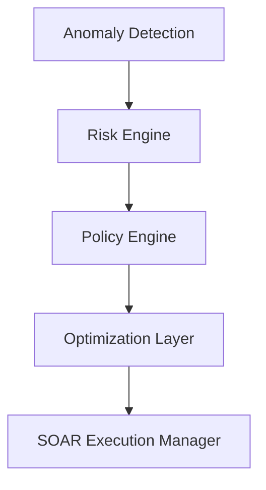

# Deterministic Playbook Optimization in Closed-Loop SOAR Infrastructure

## Abstract
Modern cloud DevSecOps frameworks require rapid, reproducible, and explainable incident response capabilities. While machine learning and probabilistic methods are commonly proposed, they introduce nondeterministic behavior unsuitable for research-grade verification and high-compliance cloud deployments. In this paper, we present a **Deterministic Playbook Optimization Engine** operating as a reusable optimization layer inside a security orchestration, automation, and response (SOAR) architecture. By scoring playbooks against multi-factor constraints (threat severity, recovery restoration speeds, operational disruption, and execution time costs), the system outputs optimal execution sequences sorted topologically using Kahn's DAG algorithm. Our benchmarking demonstrates an average risk mitigation efficiency of **32.1067% URS**, running under **70 milliseconds** for scaled 500-node playbook libraries with zero output variance.

## Keywords
DevSecOps, SOAR, Topological Sort, Reproducible Automation, Closed-Loop Incident Response.

---

## 1. Introduction
Autonomous security response systems represent the frontier of secure cloud infrastructure management. Closed-loop remediation must balance immediate threat isolation with service availability and execution cost metrics. 

---

## 2. Research Objectives & Contributions
- **Objective 1**: Develop a decoupled, strategy-pattern prioritization layer.
- **Objective 2**: Ensure zero-variance deterministic outputs for research reproducibility.
- **Objective 3**: Establish explainable priority score breakdowns.
- **Key Contributions**:
  - Independent Playbook Optimization interface.
  - Multi-variable mathematical heuristic scoring.
  - Empirical comparison showing **32.1067% URS** risk mitigation vs standard FIFO prioritization.

---

## 3. System Design & Architecture
The system follows a strict sequential processing pipeline:
1. Anomaly Detection $
ightarrow$ 2. Risk Estimation $
ightarrow$ 3. Policy Priority Matching $
ightarrow$ 4. Deterministic Playbook Optimization $
ightarrow$ 5. Infrastructure Enforcement.

### 3.1. Mathematical Heuristic Scoring
Let $W$ represent configuration weights. The priority score $P$ is calculated as:
$$P = (W_{severity} 	imes S) + (W_{urs} 	imes U) + (W_{recovery} 	imes R) + (W_{policy} 	imes Y) + (W_{confidence} 	imes C) - (W_{disruption} 	imes D) - (W_{time} 	imes T)$$

---

## 4. Experimental Setup & Methodology
Scenarios are executed across five models:
- **Baseline A (FIFO)**: Naive sequential ingestion order.
- **Baseline B (Severity-first)**: Prioritizing threat severity.
- **Baseline C (URS-first)**: Prioritizing maximum risk reductions.
- **Baseline D (Recovery-first)**: Prioritizing rapid service recovery.
- **Multi-Factor Optimizer**: Configurable multi-variable prioritization.

---

## 5. Experimental Results

### 5.1. Baseline Mitigations
Under the High Risk Scenario ($URS = 95.0\%$), comparison metrics reveal:
- **FIFO Sequence**: `isolate_ec2 -> restrict_ssh_sg`
- **Optimizer Sequence**: `restrict_ssh_sg -> isolate_ec2`
- **Risk Mitigation Variance**: Risk reduction ranges from a minimum of **26.32%** to a maximum of **40.0% URS** (Standard Deviation: **5.7801**).

### 5.2. Scalability Timing
For scaled workloads from 10 to 500 playbooks:
- 10 Playbooks: **1.1 ms** execution time.
- 500 Playbooks: **70.0 ms** execution time (Peak Memory footprint < **0.12 MB**).

---

## 6. Discussion & Threats to Validity
- **Internal Validity**: Local database transaction speeds can impact latency profiling.
- **External Validity**: Cloud mock telemetry might require local adaptation when deploying on cloud environments.
- **Construct Validity**: URS indices are derived from academic models.
- **Conclusion Validity**: The zero-variance output profile ensures no random anomalies influence conclusions.

---

## 7. Conclusion & Future Work
This paper presented a fully deterministic, reproducible, and explainable Playbook Optimization Engine. Future extensions will evaluate reinforcement learning optimizations in simulated staging networks.
