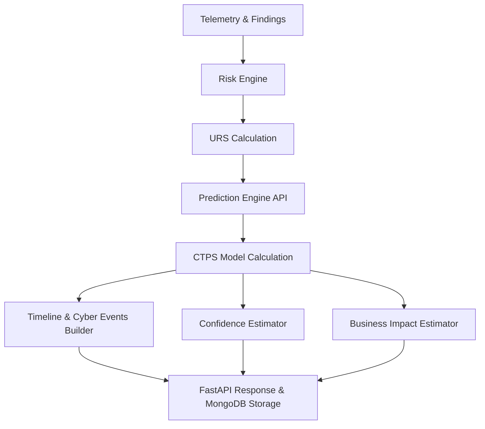

# Predictive Threat Forecasting & Future Risk Simulation Engine (Sprint 27.1)

## Architecture Overview
The Predictive Threat Forecasting microservice calculates future risk dynamics by projecting the Unified Risk Score (URS) over five default horizons: `1h`, `3h`, `6h`, `12h`, and `24h`.

Unlike reactive SOAR systems, this microservice predicts how security posture will drift if findings remain unaddressed, using a Composite Threat Propagation Score (CTPS).



---

## The CTPS Model Formula

The model is deterministic, explainable, and fully reproducible. It computes a **Composite Threat Propagation Score (CTPS)**:

$$\text{CTPS} = W_{\text{severity}} \times W_{\text{exposure}} \times W_{\text{criticality}} \times W_{\text{trend}} \times W_{\text{persistence}} \times W_{\text{remediation}} \times W_{\text{age}}$$

Where:
- $W_{\text{severity}}$: Maximum qualitative severity of open findings (Critical: 1.8, High: 1.4, Medium: 1.0, Low: 0.6, None: 0.3).
- $W_{\text{exposure}}$: Public IP exposure factor (True: 1.3, False: 1.0).
- $W_{\text{criticality}}$: Asset criticality weighting (Critical: 1.5, High: 1.2, Medium: 1.0, Low: 0.8).
- $W_{\text{trend}}$: Telemetry context trend multiplier (Worsening: 1.4, Stable: 1.0, Improving: 0.7).
- $W_{\text{persistence}}$: Scaling factor based on number of active findings ($1.0 + (\text{finding\_count} \times 0.05)$).
- $W_{\text{remediation}}$: Multiplier representing historical remediation effectiveness ($1.0 - (\text{remediation\_rate} \times 0.5)$, min 0.3).
- $W_{\text{age}}$: Vulnerability age scaling factor ($1.0 + (\text{age} / 168)$, capped at 2.0).

### Projected URS Calculation
Using $\text{CTPS}$ and a base rate of $0.02$, future URS is projected as:
- **Worsening Trend**: $\text{URS}_t = \text{URS}_0 \times (1.0 + \text{BASE\_RATE\_PER\_HOUR} \times \text{CTPS} \times t)$
- **Improving Trend**: $\text{URS}_t = \text{URS}_0 \times (1.0 - \text{BASE\_RATE\_PER\_HOUR} \times \text{CTPS} \times t)$
- **Stable Trend**: $\text{URS}_t = \text{URS}_0 \times (1.0 + \text{BASE\_RATE\_PER\_HOUR} \times \text{CTPS} \times t \times 0.3)$

*All URS projections are clamped to $[0, 100]$.*

---

## Endpoint Specification

### `GET /prediction/{resource_id}`
Retrieves a complete predictive threat forecast for the given resource.

#### Parameters:
- `current_urs` (float): Current URS.
- `finding_count` (int): Number of open findings.
- `critical_count` (int): Critical-severity findings.
- `high_count` (int): High-severity findings.
- `medium_count` (int): Medium-severity findings.
- `low_count` (int): Low-severity findings.
- `finding_max_severity` (str): Max severity of findings.
- `internet_exposed` (bool): Is the asset public-facing.
- `remediation_rate` (float): Remediation rate (0.0 to 1.0).
- `telemetry_trend` (str): "worsening" | "stable" | "improving".
- `asset_criticality` (str): "critical" | "high" | "medium" | "low".
- `vulnerability_age_hours` (float): Age of oldest open finding.

#### Response Model (`ForecastResult`):
- `resource_id`: String
- `current_urs`: Float
- `projected_urs`: Dict[String, Float]
- `ctps`: Float
- `factors`: Dict[String, Float]
- `risk_trend`: String ("increasing" | "stable" | "decreasing")
- `timeline`: List of Timeline Events
- `confidence`: Confidence Metrics Object
- `business_impact`: Business Impact Metrics Object
- `explanation`: List[String]
- `algorithm_version`: String
- `timestamp`: String

---

## MongoDB Schema
Persisted documents in collection `predicted_risk_forecasts` have the following structure:

```json
{
  "resource_id": "test-resource",
  "timestamp": "2026-07-24T22:00:00Z",
  "urs_before": 50.0,
  "projected_urs": {
    "1": 50.3,
    "3": 50.9,
    "6": 51.8,
    "12": 53.6,
    "24": 57.2
  },
  "ctps": 1.0,
  "factors": {
    "severity": 1.0,
    "exposure": 1.0,
    "criticality": 1.0,
    "trend": 1.0,
    "persistence": 1.0,
    "remediation": 0.75,
    "age": 1.0
  },
  "risk_trend": "stable",
  "timeline": [
    {
      "horizon_hours": 1,
      "projected_urs": 50.3,
      "confidence": 97.5,
      "business_impact_level": "Medium",
      "events": [
        {
          "event": "Exposed services detected by external scanners",
          "attack_phase": "Reconnaissance",
          "affected_services": ["public-facing endpoints"]
        }
      ],
      "explanation": "URS stable drift from 50.0 to 50.3 at 1h horizon."
    }
  ],
  "confidence": {
    "score": 62.5,
    "level": "Medium",
    "explanation": [
      "Telemetry (30% weight): moderate — 50/100",
      "Stability (25% weight): strong — 100/100",
      "Criticality (25% weight): moderate — 60/100",
      "Historical (20% weight): moderate — 50/100"
    ]
  },
  "business_impact": {
    "scores": {
      "overall": 42.76,
      "level": "Medium",
      "trend": "stable",
      "explanation": [
        "Highest impact category: operational (50.3/100)"
      ]
    }
  },
  "explanation": [
    "Baseline risk factors are within normal ranges"
  ],
  "algorithm_version": "CTPS-v1.0"
}
```
