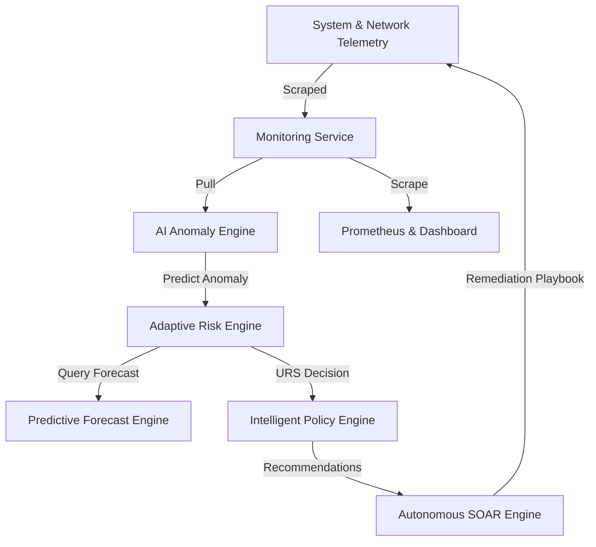

# Adaptive AI-Driven Quantum-Aware DevSecOps Framework: System Demonstration Guide

This guide describes how to run and verify the framework as an end-to-end research demonstrator. The system is rule-based, deterministic, explainable, and fully containerized.

---

## 1. Operational Architecture

The framework operates as a closed-loop security automation pipeline:



Every request flowing through the system carries a trace metadata block (`status`, `timestamp`, `request_id`, `service`, `version`, `execution_time`, `data`, `errors`) ensuring traceability.

---

## 2. Demonstration Scenarios

The `demo-scenarios/` directory contains 7 deterministic attack scenarios that trigger specific pipeline stages:

| Scenario ID | Name | Core Indicators | Target URS | Expected Decision | Remediation Playbook |
|-------------|------|-----------------|------------|-------------------|----------------------|
| `low_risk` | Normal Operations | Normal baseline telemetry | `10.5` | Normal | None |
| `ransomware` | Ransomware Encryption | 98.9% Disk, High traffic | `95.0` | Critical | Isolate Host, Snapshot VM |
| `ddos` | DDoS SYN Flood | 15k packets/sec ingress | `85.0` | Critical | WAF Rules, Enable Rate Limit |
| `crypto_mining` | Crypto Mining Malware | 98.2% CPU utilization | `91.0` | Critical | Kill mining processes |
| `insider` | Insider Threat Action | 2.5k packets/sec egress | `40.0` | Alert | Apply rate limiting WAF rules |
| `privilege_escalation` | Privilege Escalation | Elevated CPU, high anomalies | `68.0` | Critical | Disable IAM session, rotate keys |
| `data_exfiltration` | Data Exfiltration | 22k packets/sec egress | `82.0` | Critical | Block security group, rotate secret |

---

## 3. End-to-End Data Orchestration & Schemas

### API Standardized Envelope
Every API response from both Express and FastAPI nodes follows this layout:

```json
{
  "status": "success",
  "timestamp": "2026-07-24T18:50:00.000Z",
  "request_id": "REQ-GATE-1721847000000",
  "service": "Prediction Engine API",
  "version": "1.1.0",
  "execution_time": "12.34ms",
  "data": { ... },
  "errors": null
}
```

*Backward Compatibility*: If a legacy client expects keys at the root level, the route wrapper merges them into the root of the object, preventing breaking changes.

---

## 4. Step-by-Step Scenario Execution

### Step A: Deploy the Framework
Ensure all services are running:
```bash
docker compose up -d --build
```

### Step B: Run a Scenario Verification
Inject and validate telemetry for normal operations vs. attacks:
```bash
python validate_system.py
```
This script will sequentially hit the telemetry, AI, Risk, Policy, and Automation endpoints for all scenarios, measuring latency and verifying correct assertions.

### Step C: Verify Database State
Check MongoDB collections:
- `predicted_risk_forecasts` inside `devsecops_db` to verify forecasted risk trends.
- `recommendation_runs` in the policy database.
- `automation_audit` in the automation database.

### Step D: Query Prometheus Scraping Endpoints
Run curl to inspect exposed scrapable Gauges:
```bash
curl http://localhost:6001/metrics
```
Expected metrics include:
- `api_average_latency_ms`
- `prediction_latency_ms`
- `risk_engine_latency_ms`
- `automation_latency_ms`
- `policy_latency_ms`
- `pipeline_latency_ms`

---

## 5. Automated Verification Suite

Run the full suite of integration tests to ensure API contract validation and orchestration correctness:

```bash
# Run FastAPI & Express Integration Tests
python -m pytest tests/integration -v

# Run Scenario-based Pipeline Validator
python validate_system.py
```
Both of the above execution commands must display all green checks (`PASS`) for a successful deployment.
