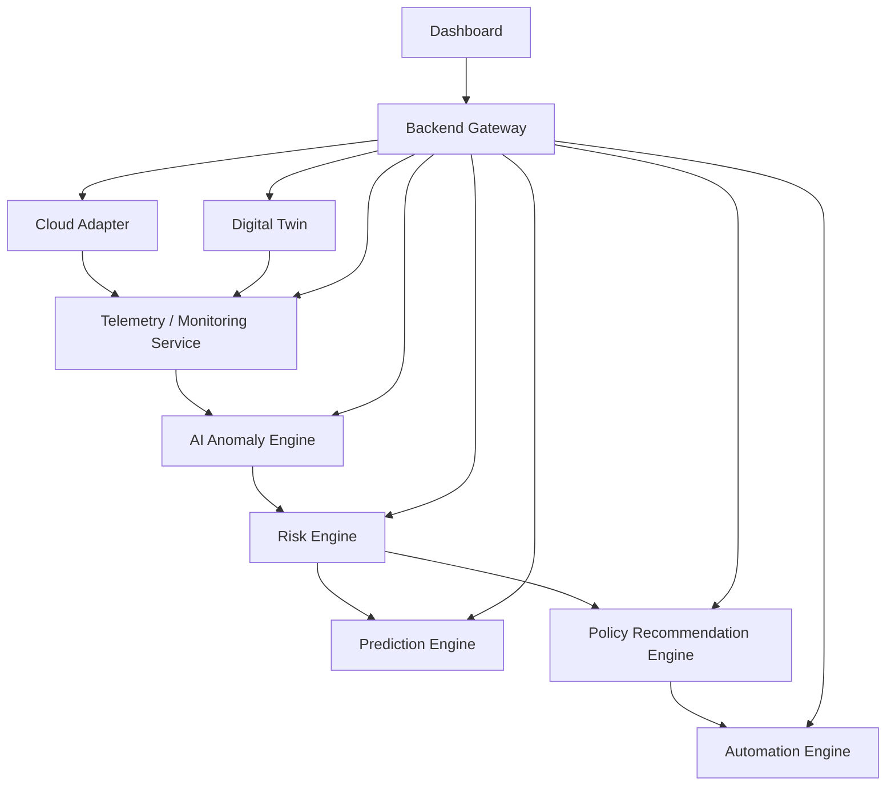

# SYSTEM INTEGRATION MANUAL

This document details the architecture, data flows, and integration configurations of the complete Adaptive AI-Driven Quantum-Aware DevSecOps Framework.

---

## 1. Overall System Architecture
The framework is a distributed, containerized system comprising twelve distinct nodes communicating via deterministic REST endpoints and persisting state in a shared MongoDB database (`devsecops_db`).

---

## 2. Microservice Node Matrix

| Microservice | Internal URL | Exposed Port | Role / Responsibility |
| :--- | :--- | :--- | :--- |
| **Backend Gateway** | `http://backend:5000` | `5000` | Gateway node coordinating UI requests to backend nodes |
| **Monitoring Service**| `http://monitoring-service:6001` | `6001` | Periodic telemetry ingestion from system components |
| **AI Anomaly Engine** | `http://ai-engine:8000` | `8000` | Neural Autoencoder reconstruction loss anomaly detection |
| **Risk Engine** | `http://risk-engine:8500` | `8500` | Calculates Static & Adaptive URS with Context Engine |
| **Prediction Engine** | `http://prediction-engine:8005` | `8005` | Forecasts future URS using the CTPS algorithm |
| **Cloud Adapter** | `http://cloud-adapter:7000` | `7000` | Ingests AWS resources and security findings |
| **Policy Engine** | `http://policy-engine:8700` | `8700` | Matches policy rules to security findings and URS |
| **Automation Engine** | `http://automation-engine:9100` | `9100` | closed-loop playbook execution ( simulation ) |
| **Digital Twin** | `http://digital-twin:8900` | `8900` | Maintains physical topology and logical graph maps |
| **Report Generator** | `http://report-generator:9000` | `9000` | Generates system audit reports |
| **Research Evaluator**| `http://research-evaluator:8800` | `8800` | Metrics analytics and statistical comparison runs |
| **Attack Simulator** | `http://attack-simulator:8600` | `8600` | Simulates security attacks for validation |

---

## 3. Data Flows & Integration Pipelines

### A. Integrated Risk Evaluation Pipeline
1. **Telemetry Capture**: `Monitoring Service` scrapes host resource usage or reads it from `Cloud Adapter`.
2. **Anomaly Classification**: Metrics are passed to `AI Engine` (`POST /predict` or `/ai/analyze`).
3. **URS Calculation**: `Risk Engine` reads anomaly state, adds Cloud Security findings penalties, and evaluates overall URS.
4. **URS Forecasting**: `Risk Engine` requests a URS forecast from `Prediction Engine` (`GET /prediction/{resource_id}`).
5. **Policy Matching**: `Risk Engine` requests recommendations from `Policy Engine` (`POST /policy/recommend`).
6. **Remediation Execution**: `Dashboard` triggers the matching remediation playbook in `Automation Engine` (`POST /automation/execute`).

---

## 4. MongoDB Database Configurations
All collections reside under the `devsecops_db` database:

1. `riskevaluations`: Static and Adaptive URS logs with explanation weights.
2. `cloud_security_findings`: Live AWS scan findings with URS penalties.
3. `cloud_assets`: Active AWS resource mappings.
4. `predicted_risk_forecasts`: Projected URS curves, timelines, and CTPS factors.
5. `recommendations`: Historical policy evaluation logs.
6. `automation_history`: Action execution scripts and rollback simulation audits.
7. `cloud_security_history`: Temporal metrics of security levels.
8. `cloud_metrics`: Telemetry timeseries records.
9. `research_evaluations`: Accuracy comparison metrics.

---

## 5. Environment Configuration & Docker Setup
All services communicate over the custom bridge network `secops_network`. Container names are mapped to hostnames in Docker.

### Key Environment Variables:
- `MONGO_URI`: MongoDB connection string.
- `PREDICTION_ENGINE_URL`: Configured in `risk-engine` (`http://prediction-engine:8005`).
- `POLICY_ENGINE_URL`: Configured in `risk-engine` (`http://policy-engine:8700`).
- `CLOUD_ADAPTER_URL`: Configured in `monitoring-service` and `automation-engine`.
- `RISK_ENGINE_URL`: Configured in `automation-engine` and `attack-simulator`.

---

## 6. Troubleshooting & Diagnostics

### Port Conflicts
- **Collision on 9100**: Host port `9100` was previously shared between `node-exporter` and `automation-engine`. `node-exporter` has been re-routed to host port `9101`, and `automation-engine` runs on `9100` to maintain dashboard access.

### Host Name Resolutions inside Containers
- Never configure microservice URLs with `localhost` or `127.0.0.1` inside Docker containers. Always use target container names (e.g. `http://risk-engine:8500`) to resolve across the Docker bridge network.
