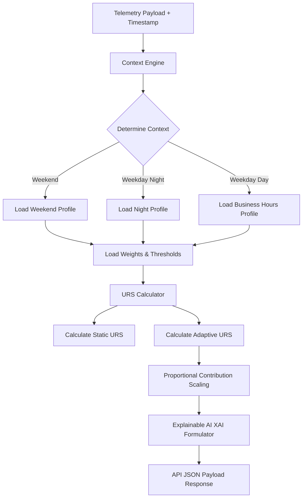
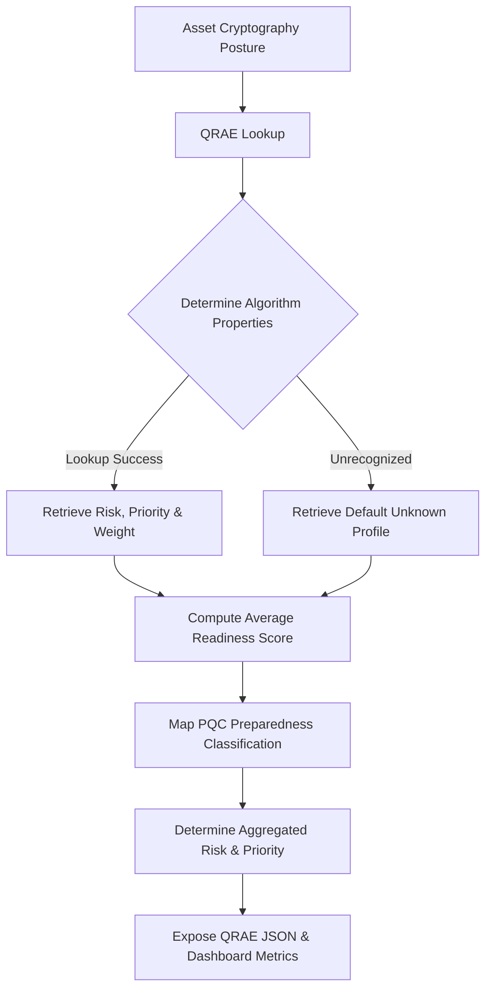

# Risk Engine

The **Risk Engine** computes the Unified Risk Score (URS) and generates automated decision logic for containment/remediation policies.

## Adaptive Context-Aware Unified Risk Score (AC-URS)

To support rigorous DevSecOps auditing and academic research, the Risk Engine has been upgraded to the **Adaptive Context-Aware Unified Risk Score (AC-URS)** framework. Rather than relying on static, hardcoded parameter weights, the engine dynamically adjusts weights and threshold mappings based on the operational context.

### Research Motivation
In complex multi-tenant cloud environments, a static security weight profile generates high false-positive rates during scheduled workload peaks (e.g. batch backups or daily build pipelines) and under-sensitizes detection during low-activity windows (e.g. weekends or night hours). AC-URS addresses this by modeling context dynamically:
- **Business Hours**: Prioritizes network activity to detect lateral movement attacks when system utilization is naturally high.
- **Night Hours**: Prioritizes CPU and memory deviations to monitor batch compute jobs and detect unauthorized background processes.
- **Weekends**: Elevates the importance of AI anomaly scoring to compensate for reduced active human monitoring.

---

### Architecture



---

### Adaptive Workflow

1. **Context Detection**: On every telemetry evaluation, the request timestamp and optional workload profile are passed to the Context Engine.
2. **Context Classification**:
   - `timePeriod`: Classified into `Morning`, `Afternoon`, `Evening`, or `Night`.
   - `dayType`: Classified into `Weekday` or `Weekend`.
3. **Weight Switching**: Loads the corresponding profile from `context_profiles.json` which adjusts:
   - Dynamic parameter weights (CPU, Memory, Network, Anomaly, Confidence, etc.).
   - Dynamic decision thresholds (normal, monitor, alert, high_risk).
4. **Comparative Calculation**: Evaluates the risk score under both static baseline weights and the dynamic context weights.
5. **Explainability Formulator**: Builds a comprehensive audit log showing exactly which context was detected, which weights were applied, and the justification for the weights.

---

### API Integration: `POST /risk/evaluate`

The endpoint returns comprehensive AC-URS metadata alongside standard evaluation attributes.

#### Request JSON Schema
```json
{
  "anomaly_score": 0.8,
  "reconstruction_error": 0.05,
  "confidence_score": 0.9,
  "cpu_usage": 85.0,
  "memory_usage": 70.0,
  "disk_usage": 40.0,
  "network_usage": 500000.0,
  "timestamp": "2026-07-20T10:00:00Z",
  "workload_profile": "Production"
}
```

#### Response JSON Schema
```json
{
  "status": "success",
  "urs": 51.55,
  "risk_score": 51.55,
  "decision": "Monitor",
  "reason": "Mild deviations detected. Increasing telemetry logging resolution.",
  "contributors": [
    {
      "parameter": "CPU",
      "value": 85.0,
      "weight": 0.15,
      "contribution": 12.75,
      "reason": "CPU utilization exceeded adaptive threshold. (Adaptive Weight: 0.15)"
    }
  ],
  "topContributor": "Network",
  "timestamp": "2026-07-20T10:00:00Z",
  "context": {
    "timePeriod": "Morning",
    "dayType": "Weekday",
    "profile": "Business Hours"
  },
  "adaptiveWeights": {
    "cpu": 0.15,
    "memory": 0.15,
    "network": 0.35,
    "anomaly": 0.20,
    "confidence": 0.10,
    "historical": 0.05
  },
  "comparison": {
    "staticURS": 51.55,
    "adaptiveURS": 61.25,
    "difference": 9.7,
    "improvement": "Increased sensitivity to threats during high-activity context."
  },
  "contextConfidence": 0.95,
  "profileVersion": "1.0.0",
  "adaptationReason": "Network activity receives higher importance during business hours because lateral movement attacks are more probable."
}
```

---

## Quantum Readiness Assessment Engine (QRAE)

To evaluate post-quantum preparedness of monitored cloud assets, the Risk Engine incorporates a **Quantum Readiness Assessment Engine (QRAE)**. QRAE scans the cryptographic configurations of assets (such as keys, signature schemes, and TLS parameters) to determine their security standing against future quantum computational threats.

### QRAE Architecture & Workflow



### Scoring Methodology

The Quantum Readiness Score is computed by taking the average of the relative readiness weights of all cryptographic algorithms identified on the asset. The score ranges from **0 to 100** and is mapped to the following classifications:

- **0–25**: `Poor` — High reliance on weak cryptosystems (e.g. RSA-2048). Immediate remediation required.
- **26–50**: `Moderate` — Hybrid posture, legacy algorithms in active use. Planned migration required.
- **51–75**: `Good` — Transitioning to stronger elliptic curves (e.g. ECC P-384) or hybrid exchange models.
- **76–100**: `Excellent` — Verified implementation of post-quantum cryptographic standards (e.g. ML-KEM).

### Supported Algorithm Profiles

| Cryptosystem | Quantum Risk | Migration Priority | Readiness Weight | Recommendation |
| :--- | :--- | :--- | :--- | :--- |
| **RSA-2048** | Very High | Immediate | 15 | Migrate to ML-KEM (Kyber) hybrid TLS. |
| **RSA-4096** | High | Immediate | 25 | Migrate to ML-KEM (Kyber) hybrid TLS. |
| **ECC P-256** | Medium | Planned | 55 | Transition to hybrid PQC key exchange. |
| **ECC P-384** | Medium | Planned | 60 | Transition to hybrid PQC key exchange. |
| **Ed25519** | Medium | Planned | 65 | ML-DSA (Dilithium) signatures. |
| **ML-KEM (Kyber)** | Low | Completed | 95 | Already PQC-ready. |
| **Unknown** | High | Immediate | 10 | Audit asset to identify cryptosystem. |

---

## Running Tests

Verify all AC-URS, XAI, and QRAE functions:
```bash
$env:MONGO_URI=''; python -m pytest
```


